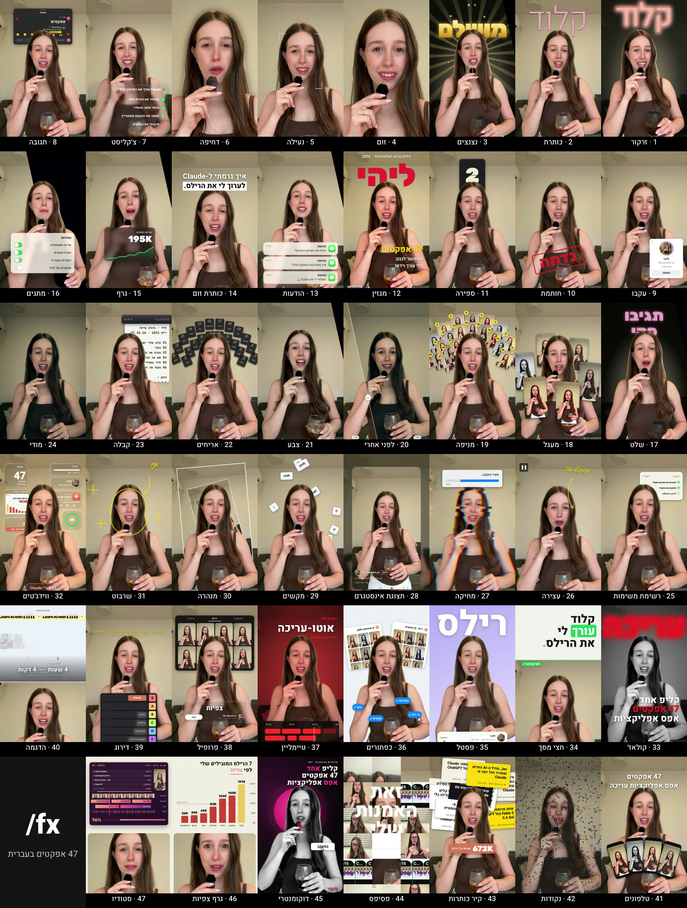

# claude-hebrew-video-effects

<div dir="rtl">

47 אפקטים לסרטוני רילס, בפקודה אחת בעברית בתוך Claude.
גוררים סרטון של מישהו שמדבר למצלמה, כותבים `/fx זרקור על המילה קלוד`, וקלוד עורך.
האפקטים עוקבים אחרי הראש, טקסט יכול לשבת מאחורי האדם בסרטון, והכול בעברית ומיושר לימין.

</div>



Hebrew video effects for talking-head reels, as a Claude Code skill. Based on
[claude-video-effects](https://github.com/Vibha-Ramprakash/claude-video-effects) by Vibha Ramprakash (MIT).

## התקנה · Install

```bash
git clone https://github.com/lihi-atzmoni/claude-hebrew-video-effects ~/.claude/skills/claude-hebrew-video-effects
cp -r ~/.claude/skills/claude-hebrew-video-effects/fx ~/.claude/skills/fx
```

The second line adds the short `/fx` command.

Needs `python3`, `ffmpeg` and Node.js 22+ (the [HyperFrames](https://hyperframes.dev) CLI runs through `npx`, nothing else to install).

## שימוש · Usage

<div dir="rtl">

בתוך Claude Code, גוררים סרטון ואז:

- `/fx ווידג׳טים`
- `/fx זרקור על המילה קלוד`
- `/fx צ׳קליסט משנייה 3 עד 6`
- `/fx דוקומנטרי`

בפעם הראשונה קלוד גוזר את האדם בסרטון מהרקע (כמה דקות לכל דקה של וידאו). מהפעם השנייה זה הרבה יותר מהיר.
את כל האפקטים והאפשרויות שלהם אפשר לראות בטבלה ב-[SKILL.md](SKILL.md).

</div>

## כל האפקטים · All effects

<div dir="rtl">

המספרים תואמים לתמונה למעלה. האפשרויות של כל אפקט (טקסט, צבע, זמנים) מפורטות ב-[SKILL.md](SKILL.md).

</div>

<table dir="rtl">
<tr><th>#</th><th>פקודה</th><th>מה זה עושה</th></tr>
<tr><td>1</td><td><code>/fx זרקור</code></td><td>החדר נכבה, רק האדם בסרטון נשאר מואר, ומילה זוהרת מופיעה מאחורי הראש</td></tr>
<tr><td>2</td><td><code>/fx כותרת</code></td><td>מילה ענקית נופלת מלמעלה ונעצרת מאחורי הראש</td></tr>
<tr><td>3</td><td><code>/fx נצנצים</code></td><td>קרני זהב מאחורי הראש, מילה מוזהבת וניצוצות</td></tr>
<tr><td>4</td><td><code>/fx זום</code></td><td>זום מהיר פנימה על הפנים</td></tr>
<tr><td>5</td><td><code>/fx נעילה</code></td><td>סוגריים לבנים ננעלים על הפנים ועוקבים אחריהן, עם זום איטי. הכי טוב 1.5–2 שניות</td></tr>
<tr><td>6</td><td><code>/fx דחיפה</code></td><td>זום איטי וקולנועי, והרקע מיטשטש</td></tr>
<tr><td>7</td><td><code>/fx צ׳קליסט</code></td><td>רשימת משימות של Claude מתחת לסנטר, כל שורה מסתובבת ואז מקבלת ✓</td></tr>
<tr><td>8</td><td><code>/fx תגובה</code></td><td>חלון תגובות של אינסטגרם מעל הראש: מילה מוקלדת, מתפרסמת ומקבלת לב ותשובה</td></tr>
<tr><td>9</td><td><code>/fx עקבו</code></td><td>כרטיס "מוצע עבורך" של אינסטגרם עם תמונת פרופיל, ולחיצה על מעקב</td></tr>
<tr><td>10</td><td><code>/fx חותמת</code></td><td>חותמת גומי אדומה נוחתת על המסך</td></tr>
<tr><td>11</td><td><code>/fx ספירה</code></td><td>שעון ספירה לאחור 3, 2, 1 מעל הראש</td></tr>
<tr><td>12</td><td><code>/fx מגזין</code></td><td>הסרטון הופך לשער של מגזין, ושם המגזין מאחורי הראש</td></tr>
<tr><td>13</td><td><code>/fx הודעות</code></td><td>התראות הודעה נכנסות אחת אחרי השנייה</td></tr>
<tr><td>14</td><td><code>/fx כותרת זום</code></td><td>זום פנימה וכותרת בשתי שורות, השנייה בתוך מלבן לבן</td></tr>
<tr><td>15</td><td><code>/fx גרף</code></td><td>כרטיס זכוכית עם גרף שעולה ומספר שסופר</td></tr>
<tr><td>16</td><td><code>/fx מתגים</code></td><td>כרטיס הגדרות של אייפון, המתגים נדלקים אחד אחרי השני</td></tr>
<tr><td>17</td><td><code>/fx שלט</code></td><td>החדר נכבה ושלט לד מקליד את עצמו מאחורי הראש</td></tr>
<tr><td>18</td><td><code>/fx מעגל</code></td><td>תמונות של רילס מסתובבות במעגל סביב הראש</td></tr>
<tr><td>19</td><td><code>/fx מניפה</code></td><td>כרטיסי רילס ממוספרים נבנים למניפה של 3 שורות מאחורי הראש</td></tr>
<tr><td>20</td><td><code>/fx לפני אחרי</code></td><td>סליידר לפני/אחרי עובר על המסך</td></tr>
<tr><td>21</td><td><code>/fx צבע</code></td><td>פילטר צבע על כל הסרטון</td></tr>
<tr><td>22</td><td><code>/fx אריחים</code></td><td>אריחים ממוספרים נפרשים בקשת מעל הראש</td></tr>
<tr><td>23</td><td><code>/fx קבלה</code></td><td>מדפסת של Claude מדפיסה קבלה ארוכה ליד הראש</td></tr>
<tr><td>24</td><td><code>/fx מודי</code></td><td>צבעים כהים ומודיים עם שוליים כהים</td></tr>
<tr><td>25</td><td><code>/fx רשימת משימות</code></td><td>רשימת משימות ליד הראש, השורות מסומנות אחת אחרי השנייה</td></tr>
<tr><td>26</td><td><code>/fx עצירה</code></td><td>הפריים קופא וחצים בכתב יד מצביעים על האדם בסרטון</td></tr>
<tr><td>27</td><td><code>/fx מחיקה</code></td><td>אייקונים של אפליקציות רועדים ונמחקים, עם גליץ׳</td></tr>
<tr><td>28</td><td><code>/fx תצוגת אינסטגרם</code></td><td>הסרטון מתכווץ למסך רילס של אינסטגרם, עם אייקונים, לייקים, פרופיל וכיתוב</td></tr>
<tr><td>29</td><td><code>/fx מקשים</code></td><td>מקשי מקלדת נופלים מאחורי הראש</td></tr>
<tr><td>30</td><td><code>/fx מנהרה</code></td><td>הפריים נכנס לתוך עצמו שוב ושוב</td></tr>
<tr><td>31</td><td><code>/fx שרבוט</code></td><td>שחור-לבן, ומרקר מקיף את הפנים עם המילה "אני"</td></tr>
<tr><td>32</td><td><code>/fx ווידג׳טים</code></td><td>ווידג׳טים מזכוכית סביב הראש, ו"נערך ע״י Claude" למטה</td></tr>
<tr><td>33</td><td><code>/fx קולאז׳</code></td><td>שחור-לבן, מילה אדומה ענקית מאחורה ו-3 שורות שנוחתות</td></tr>
<tr><td>34</td><td><code>/fx חצי מסך</code></td><td>כרטיס כותרת יורד מלמעלה ודוחף את הסרטון למטה</td></tr>
<tr><td>35</td><td><code>/fx פסטל</code></td><td>חדר לילך, מילה ענקית מאחורה וכרטיס פרופיל עם מעקב</td></tr>
<tr><td>36</td><td><code>/fx כפתורים</code></td><td>חדר משבצות, לוחות רילס מאחורה וסמן שלוחץ על כפתורים כחולים</td></tr>
<tr><td>37</td><td><code>/fx טיימליין</code></td><td>לוק אדום, טיימליין עריכה, REC וטיים-קוד</td></tr>
<tr><td>38</td><td><code>/fx פרופיל</code></td><td>גריד של רילס על הקיר ומונה צפיות</td></tr>
<tr><td>39</td><td><code>/fx דירוג</code></td><td>טבלת דירוג, ו-Claude עף לשורה S</td></tr>
<tr><td>40</td><td><code>/fx הדגמה</code></td><td>סרטון של מה שמדברים עליו בחצי העליון, האדם בחצי התחתון, וכיתוב לבן</td></tr>
<tr><td>41</td><td><code>/fx טלפונים</code></td><td>טלפונים עם רילס נפרשים כמו קלפים</td></tr>
<tr><td>42</td><td><code>/fx נקודות</code></td><td>הפריים נבנה מנקודות זוהרות ואז נחשף</td></tr>
<tr><td>43</td><td><code>/fx קיר כותרות</code></td><td>כותרות נערמות מאחורה, ואז סך הצפיות קופץ</td></tr>
<tr><td>44</td><td><code>/fx פסיפס</code></td><td>גריד של תמונות מהבהב מסביב, ו-3 מילים נבנות מעל הראש</td></tr>
<tr><td>45</td><td><code>/fx דוקומנטרי</code></td><td>שחור-לבן על רקע כהה, עיגול ורוד מאחורי הראש, כותרת ב-3 שורות, כפתור "עקבו" שנלחץ ושם למטה</td></tr>
<tr><td>46</td><td><code>/fx גרף צפיות</code></td><td>פאנל עם גרף עמודות של הרילס הכי נצפים יורד מלמעלה, והסרטון בחלון מעוגל למטה</td></tr>
<tr><td>47</td><td><code>/fx סטודיו</code></td><td>חלון הרינדור של Claude: שלבים שמסומנים, טראקים, סמן ואחוזים, והסרטון בחלון מעוגל למטה</td></tr>
</table>

## Credits

- Effects ported from [claude-video-effects](https://github.com/Vibha-Ramprakash/claude-video-effects) by Vibha Ramprakash, MIT.
- Fonts: Heebo, Rubik, Frank Ruhl Libre, Gveret Levin, all SIL Open Font License 1.1 (licenses in `engine/fonts/`).
- Animation: [GSAP](https://gsap.com) (GSAP Standard License). Rendering: [HyperFrames](https://hyperframes.dev).

MIT, see [LICENSE](LICENSE).
